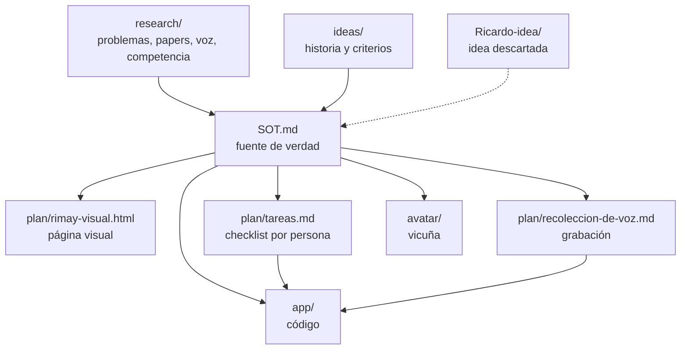

# Rimay — fuente de verdad (SOT)

> **Versión SOT-11 · sábado 24 de octubre de 2026, 09:15 PT**
>
> **Regla:** toda decisión nueva entra aquí primero. Si otro documento contradice este, **gana este** y el otro
> está desactualizado. La página visual (`plan/rimay-visual.html`, https://claude.ai/artifact/4E7Si4gN9mpF34eha55jpH)
> se regenera desde este archivo y lleva **el mismo número de versión**: si los números no coinciden, no están sincronizados.

### Qué cambió en cada versión (léelo primero, Ricardo)

- **SOT-11 (sáb 09:15).** **Rimay sirve a los dos lados (D27)**: lo puede usar el personal de salud o el paciente quechuahablante. Onboarding de tres pasos: idioma → nombre → ¿personal de salud o paciente? La interfaz sale en el idioma elegido. El rol cambia solo el texto de algunas pantallas, el prompt del agente y el tipo de resumen; el núcleo es el mismo. Las pantallas en quechua las redacta Claude y **las revisa la mamá de Freddy** antes del pitch.
- **SOT-10 (sáb 09:05).** **UI: se construye sobre el tablero de Pencil (D26)**, con 11 ajustes para el flujo real: estado «Pensando» con pasos, texto antes que voz, modo ensayo en ámbar (rojo solo para dato crítico), tocar para hablar (no mantener), quién habla en el botón y alternancia automática, franja textil, historial de la consulta, boca de Chaski con el volumen real. Detalle: `design/specs/02-pulido-ui.md`. La app vive en `movil/` (Expo SDK 58). También se registra D25 (cuadernillo + NLLB-200).
- **SOT-9 (sáb 07:50).** **Paleta decidida (D24)**: «Chaski + textil», tokens en `design/tokens.json`. Loops de Chaski listos: escuchando y presentarse cierran solos, pensando y no_entendi en ping-pong; hablando se hace en la app alternando reposo/hablando con el volumen del audio. Entrevista Mom Test a la mamá de Freddy en `plan/entrevista-personal-salud.md`. Voz con emoción y clonación al backlog. **Corrección:** la GPU es una A10G de 23 GB, no 40 (medido por Ricardo).
- **SOT-8 (sáb 01:50).** **Foco cerrado (D23):** traducción literal + ajuste fino de reconocimiento y voz. Las tres formas de interpretar que propuso Freddy van al backlog (§13). Además: los videos de Chaski se piden con el cuadro ya en 16:9 (`avatar/estados-16x9/`), porque en cuadrado Flow hacía zoom.
- **SOT-7 (sáb 01:05).** **Chaski tiene sus 6 cuadros** (reposo + 5 estados) en `avatar/estados/`, generados desde la especificación JSON `avatar/chaski.json` (identidad fija + un bloque por estado; los prompts salen de ahí, en `avatar/prompts/`). Para cambiar algo de Chaski se edita el JSON y se regenera.
- **SOT-6 (sáb 00:58).** **El avatar es Chaski** (D22): la vicuña 3D sentada con audífonos de intérprete y bufanda teal, `avatar/opciones/2d-3d-audifonos.png`. Los 5 estados se generan el sábado a partir de esa imagen.
- **SOT-5 (sáb 00:50).** **Claude es el núcleo (D19, §3)**: los modelos de voz son los oídos y la boca, Claude es el que entiende, ve y decide. Siete trabajos:
  - **Ver (F9):** lee la receta escrita a mano y la caja, y **cruza la caja con lo que dijo la enfermera** (si ella dijo paracetamol y la caja dice ibuprofeno, avisa). Si no está seguro de leer algo, no adivina.
  - **Corregir (F10):** el reconocimiento de quechua da varios intentos y Claude elige y corrige con el contexto de la consulta. **Cuarto número para el jurado: cuánto baja el error con Claude.** Se hace entre los dos: tu modelo da las N mejores, Freddy hace la corrección.
  - **Entender** lo que quiso decir cada lado, estilo Wispr Flow (F3).
  - **Auditarse** antes de hablar (F4, construido).
  - **Juzgar** si el paciente entendió (F6).
  - **Resumir la consulta (F11):** nota en castellano para la historia clínica y audio en quechua para llevar a casa.
  - **Decidir el siguiente paso:** pedir repetir, avisar a la enfermera o seguir.
  - Además: **el avatar es una vicuña** (D20, §10, 4 opciones en `avatar/opciones/`) y **las tareas por persona están en [`plan/tareas.md`](plan/tareas.md)** (D21). Tú armas las frases y preguntas que graban las familias.
- **SOT-4 (sáb 00:20).** App nativa iOS por TestFlight (D14), modelo de Claude elegido midiendo (D15), Cartesia para el castellano (D16), avatar (D17), la mamá de Freddy en la prueba y el pitch (D18), plan del sábado (§11).
- **SOT-3 (vie 23:50).** Rimay pasa a ser intérprete cara a cara para el personal de salud (D9–D12). Nace este archivo.

> La página visual está en el repo: abre `plan/rimay-visual.html` en el navegador (el enlace de claude.ai es privado de Freddy).

---

## 1. El producto, hoy

**Rimay es un intérprete castellano ↔ quechua chanka que el personal de salud tiene en su celular.** La enfermera
habla y Rimay lo dice en quechua; el paciente responde y Rimay detecta que es quechua y se lo dice a ella en castellano.
Antes de decir algo, Rimay se audita: si una dosis, una hora o una fecha cambió en la traducción, no lo dice.

| | |
|---|---|
| **Quién la usa** | **Los dos lados (D27)**: el personal de salud de la posta (enfermera, técnico, obstetra) **o** el paciente quechuahablante, en su propio celular |
| **Quien se beneficia** | Los pacientes quechuahablantes de la **posta de Pilpichaca (Huancavelica)**, en cualquier atención: niño, fiebre, diarrea, presión, diabetes, embarazo, adulto mayor |
| **Dónde** | En la consulta, cara a cara, con el celular entre los dos |
| **Forma** | **App nativa de iOS**, instalada por TestFlight con la cuenta Apple Developer de Freddy. Los modelos de voz corren en la GPU de Ricardo |
| **Inspiración** | Wispr Flow: un modelo que entiende lo que quisiste decir y lo deja claro |

### Una consulta, paso a paso
1. La enfermera habla en castellano.
2. Rimay **entiende lo que quiso decir**: limpia muletillas y frases a medias, deja los números explícitos.
3. **Auditoría**: traduce al chanka, retraduce a ciegas, compara dosis, horas, días y citas con código. Si algo cambió, no lo dice y le muestra a la enfermera qué revisar. *(construido)*
4. Rimay **lo dice en quechua chanka**, en voz alta; la enfermera lo ve en pantalla.
5. El paciente responde. Rimay **detecta el idioma** solo.
6. Rimay **entiende lo que quiso decir el paciente** y se lo dice a la enfermera en castellano, avisando si no está seguro.
7. Al final: **«¿Me lo repite?»**. Rimay marca qué entendió el paciente y qué no.

### Por qué importa
Una indicación que no se entiende es un tratamiento que no funciona: dosis equivocada, pastilla que se deja, control
al que no se vuelve. En Pilpichaca, la mamá de Freddy es la única enfermera que habla quechua. En toda Huancavelica hay
**52 servidores públicos bilingües certificados** (~1 por cada 4,000 quechuahablantes). Solo el **1%** de los
establecimientos de salud del país tiene atención intercultural. Fuentes: `research/problemas-lenguas-originarias.md`.

---

## 2. Funciones

| # | Función | Lo difícil | Estado |
|---|---|---|---|
| F1 | **Entender quechua hablado** | Casi no hay datos de voz en chanka. Se ajusta con las voces de las familias y se mide con una voz que el modelo nunca escuchó | por hacer · Ricardo |
| F2 | **Detectar el idioma solo** | Quechua o castellano en cada turno, sin botones. `facebook/mms-lid-512` incluye `quy` y `spa` (verificado 23-oct); precisión por medir | por hacer · Ricardo |
| F3 | **Entender lo que quiso decir** | Claude limpia la voz de la enfermera y el texto ruidoso del quechua, sin inventar ni quitar datos | por hacer · Freddy |
| F4 | **Auditar antes de hablar** | Retraducción a ciegas + comparación por código | ✅ construido, 20 pruebas · `app/rimay/` |
| F5 | **Hablar quechua** | Voz chanka de Meta (`facebook/mms-tts-quy`), ajustada con la voz de la mamá de Freddy | voz base probada 23-oct · `muestras/` |
| F6 | **«¿Me lo repite?»** | Comparar lo repetido con la indicación | por hacer · Freddy |
| F7 | **Mejora con el uso** | Cada corrección de la enfermera entra al glosario y a los datos del siguiente ajuste | por hacer |
| F9 | **Leer la receta y la caja (Claude visión)** | Foto de la receta escrita a mano y de la caja → medicamento, dosis, frecuencia. **Cruza la caja con lo que dijo la enfermera**: si ella dijo paracetamol y la caja dice ibuprofeno, avisa. Si no está seguro de leer algo, no adivina | por hacer · Freddy |
| F10 | **Claude corrige la transcripción en quechua** | El reconocimiento devuelve sus N mejores intentos; Claude elige y corrige con el contexto de la consulta (qué preguntó la enfermera) y el glosario. Se mide: errores con y sin Claude | por hacer · Freddy + Ricardo |
| F11 | **Resumen de la consulta** | Al cerrar: nota en castellano para la historia clínica y audio en quechua para que el paciente se lleve a casa | por hacer · Freddy |
| F12 | **Notas en segundo plano + resumen con checklist** | Claude escucha toda la consulta y toma notas, para que al final el personal tenga claro qué se dijo y qué entendió el paciente. **Para qué situación** (consulta, emergencia, farmacia, control prenatal, CRED, visita) se decide con la entrevista al personal de salud (bloques 4 y 5 de `plan/entrevista-personal-salud.md`) | idea de Freddy, sáb 08:02 · por validar |
| F8 | **Evaluación chanka-salud** | Claude vs Google Translate en indicaciones reales, calificado por la enfermera (método Kong et al., 2026) | por hacer · Freddy + mamá |

---

## 3. Claude es el cerebro (D19)

Los modelos de voz son los oídos y la boca. **Claude es el que entiende y decide.** Siete trabajos, todos centrales:

| Trabajo de Claude | Función |
|---|---|
| Ver: leer la receta y la caja, y cruzarlas con lo que dijo la enfermera | F9 |
| Corregir lo que el reconocimiento entendió en quechua, con el contexto de la consulta | F10 |
| Entender lo que quiso decir cada lado (estilo Wispr Flow) | F3 |
| Traducir y auditarse antes de hablar | F4 |
| Juzgar si el paciente entendió («¿me lo repite?») | F6 |
| Resumir la consulta para la historia clínica y para el paciente | F11 |
| Decidir el siguiente paso de la conversación: pedir repetir, avisar a la enfermera, seguir | orquestador |

**La frase del pitch:** *«Los modelos de voz son los oídos y la boca. Claude es el que entiende, el que ve la receta y
el que se niega a decir una dosis que no está seguro de haber traducido bien.»*

## 3b. Lo técnicamente difícil (lo que ve el jurado)

Tres números, medidos con honestidad, aunque salgan malos:
1. **Errores al entender chanka hablado**: modelo de Meta tal cual → + vocabulario de la posta → + ajuste fino con las familias. Medido con una persona que no está en el entrenamiento.
2. **Errores al traducir al chanka**: Claude contra Google Translate, calificados por la enfermera.
3. **Errores que la auditoría atrapa** antes de que Rimay hable.
4. **Cuánto baja el error del quechua cuando Claude corrige la transcripción** (F10).

Más: precisión de la detección de idioma, y la espera por turno.

---

## 4. Tecnología

| Pieza | Qué usamos | Estado |
|---|---|---|
| Traducir, entender, auditar | Claude (`claude-opus-5`) vía SDK de Python, salida estructurada | auditoría hecha |
| Entender voz quechua | Meta Omnilingual ASR `quy` + vocabulario KenLM + ajuste fino | sábado |
| Entender voz castellano | Por decidir: medir Whisper contra Omnilingual `spa` (o el de Cartesia, si tiene) | sábado |
| Detectar idioma | `facebook/mms-lid-512` limitado a `quy`/`spa` | sábado |
| Hablar quechua | `facebook/mms-tts-quy` ajustado (VITS) | base probada |
| Hablar castellano | **Cartesia** (con sus créditos; suma su track) | sábado |
| Entrenar y servir los modelos | VM de Ricardo, GPU de 40 GB | probar hoy |
| App | **iOS nativa con Expo (React Native) + EAS Build → TestFlight**. Plan B: correrla en el iPhone de Freddy con Expo | sábado |
| Conexión app ↔ modelos | La VM de Ricardo expuesta por **HTTPS** (iOS no permite HTTP plano) | sábado temprano |

Licencias: Omnilingual y Siminchik libres; MMS-TTS y MMS-LID no comerciales (bien para el hackathon). Detalle: `research/voz-quechua-modelos.md`.

---

## 5. Equipo

| Freddy | Ricardo | Familias |
|---|---|---|
| Claude: entender, traducir, auditar, «¿me lo repite?» · app · evaluación chanka con su mamá · pitch y Devpost | Datos de voz · reconocimiento (pasos 0-1-2) · detección de idioma · voz de Rimay · métricas y gráficos | Graban frases de posta y respuestas libres en chanka · la mamá de Freddy transcribe, revisa el glosario y califica |

**Tareas por persona, con checklist: [`plan/tareas.md`](plan/tareas.md).** Protocolo de grabación: `plan/recoleccion-de-voz.md`.

---

## 6. Registro de decisiones

| # | Cuándo (PT) | Decisión | Por qué |
|---|---|---|---|
| D1 | vie 18:30 | Track principal: Anthropic «Claude for Public Benefit» | Freddy y Ricardo son peruanos; el track premia una comunidad concreta |
| D2 | vie 19:30 | Repo en la cuenta personal `Freddyx14/cal-hacks`, Ricardo invitado | No es un cliente de Loopmind |
| D3 | vie 20:20 | Se descarta incendios | La detección ya la resuelve Satellites on Fire (US$2.7M) |
| D4 | vie 21:10 | Rumbo: quechua en salud | La mamá de Freddy es la única enfermera quechuahablante de la posta de Pilpichaca |
| D5 | vie 22:40 | Ajuste fino de voz con las familias, medido antes y después | Padres de Freddy y papá de Ricardo hablan chanka; da el núcleo técnico |
| D6 | vie 23:08 | Rimay sobre corredores de extorsión | El propio análisis de Ricardo mostró que el modelo de escalamiento no le gana al baseline |
| D7 | vie 23:08 | El entrenamiento corre en la VM de Ricardo (**GPU A10G, 23 GB**; se dijo 40, Ricardo midió 23) | Alcanza: el ASR usa 3.4 GB |
| D8 | vie 23:33 | Salud general, no solo gestantes | Más voces familiares = más datos; la comunidad es la posta, no una condición |
| D9 | vie 23:41 | **Usuaria principal: el personal de salud**, no el paciente | Lo usan en la consulta, cara a cara |
| D10 | vie 23:41 | **App de intérprete con voz en los dos sentidos**, no WhatsApp | Conversación en vivo; la enfermera habla, Rimay habla en quechua, el paciente responde |
| D11 | vie 23:41 | **Detección automática de idioma** en cada turno | Nadie debería tocar un botón para cambiar de idioma |
| D12 | vie 23:41 | **Entender la intención, estilo Wispr Flow** | Que lo dicho a medias llegue claro de los dos lados |
| D13 | vie 23:50 | Este archivo es la fuente de verdad; la página visual se sincroniza con él | Pedido de Freddy |
| D14 | sáb 00:14 | **App nativa de iOS por TestFlight** | Freddy tiene la cuenta Apple Developer; se muestra como app de prueba |
| D15 | sáb 00:14 | **El modelo de Claude se elige midiendo**: velocidad y acierto en el mismo set de prueba, y se queda uno | En una conversación en vivo la espera importa tanto como el acierto |
| D16 | sáb 00:14 | **Cartesia para la voz en castellano** | Sus créditos y su track |
| D17 | sáb 00:14 | **Avatar** que presenta Rimay y lo hace cercano | Más familiar para el paciente; lo pidió Freddy (ver §10) |
| D18 | sáb 00:14 | **La mamá de Freddy prueba por videollamada y, si puede, aparece en el pitch** | Usuaria real, voz real |
| D19 | sáb 00:33 | **Claude es el núcleo**: visión de receta y caja, corrección de la transcripción, intención, auditoría, «¿me lo repite?», resumen y orquestación | El track es de Anthropic; Claude tiene que ser central, no un adorno |
| D20 | sáb 00:33 | **El avatar es una vicuña**, juguetona y animada, con otro nombre | Elección de Freddy |
| D25 | sáb 08:35 | **El cuadernillo pide escribir la frase en quechua y leer en voz alta exactamente lo escrito** (75 frases, foto de cada hoja + una nota de voz por frase). Traducción: **NLLB-200 de Meta** (`facebook/nllb-200-distilled-600M`, incluye `quy_Latn`, licencia no comercial) ajustado con esos pares | Traducir, entender y hablar necesitan **texto escrito**: con solo voz habría que transcribir ~450 audios. Así cada persona trae su texto y su audio alineados. Omnilingual MT (Meta, mar-2026) no tiene pesos publicados |
| D27 | sáb 09:05 | **Rimay es para los dos lados: personal de salud y paciente.** Onboarding: (1) idioma, castellano o quechua; (2) nombre; (3) ¿personal de salud o paciente? La interfaz va en el idioma elegido. El rol cambia algunos textos de la vista, el system prompt del agente y el resumen final (nota clínica para el personal, instrucciones para llevar a casa para el paciente). No son dos apps | Freddy: un paciente que no habla castellano también llega a un servicio de salud y merece los mismos beneficios, el resumen de lo que escuchó y la auditoría con Claude |
| D26 | sáb 09:05 | **La UI se construye sobre el tablero de Pencil** (`design/rimay-pen.png`), con los ajustes de `design/specs/02-pulido-ui.md`. La app está en `movil/` | Elección de Freddy entre Pencil y Claude Design; los ajustes salen de los tiempos reales del servicio (~5 s por turno) y de la tasa de bloqueos del modo estricto |
| D24 | sáb 07:48 | **Paleta «Chaski + textil»**: fondo crudo `#F6F4F1`, acción teal `#0E6B64` (6.4:1), quechua canela `#A85A2A` (5.0:1), rojo solo para bloqueo, avisos siempre con ícono, una franja textil escalonada como único adorno. Tokens: `design/tokens.json` | Reutiliza lo diseñado, es la más segura y combina con el fondo cálido de Chaski; la franja da la identidad que faltaba |
| D23 | sáb 01:40 | **El foco del fin de semana es la traducción literal** (modo 1 abajo) **más el ajuste fino de reconocimiento y voz en chanka**. Los modos 2 y 3 van al backlog | Lo que se puede hacer bien en 30 horas; los otros modos se suman si sobra tiempo |
| D22 | sáb 00:54 | **El avatar es Chaski: la vicuña 3D con audífonos y micrófono de intérprete y bufanda teal** (`avatar/opciones/2d-3d-audifonos.png`) | Se entiende de un vistazo que interpreta y traduce |
| D21 | sáb 00:45 | **Tareas por persona en `plan/tareas.md`**; Ricardo arma las preguntas y frases que graban las familias | Seguimiento claro |

---

## 7. Por decidir (con recomendación)

| # | Pregunta | Recomendación | Estado |
|---|---|---|---|
| P1 | ¿App web o nativa? | — | ✅ cerrada: nativa iOS (D14) |
| P2 | ¿Qué modelo de Claude en la conversación? | Medir `claude-opus-5`, `claude-sonnet-5` y `claude-haiku-4-5` en el mismo set: segundos por turno y errores atrapados. Quedarse con el más rápido que no pierda acierto en la auditoría | abierta · se decide el sábado con números (D15) |
| P3 | ¿Voz en castellano? | — | ✅ cerrada: Cartesia (D16) |
| P4 | Nombre final | Ver lista abajo; decidirla con la mamá de Freddy | abierta |
| P5 | ¿Cómo es el avatar? | — | ✅ cerrada: Chaski, vicuña 3D con audífonos (D20, D22) |
| P6 | ¿La mamá de Freddy puede el domingo de 12:30 a 14:30 (hora de Lima)? | Preguntarle hoy | abierta · Freddy |

### Nombres propuestos (P4)
⚠️ **El significado y la escritura en chanka los confirma la mamá de Freddy.** No se usa ninguno en público sin eso.

| Nombre | Lo que entendemos que significa | Por qué podría servir |
|---|---|---|
| **Rimay** | hablar | Corto, dice lo que hace. El favorito de Freddy |
| **Rimanakuy** | conversar, hablar entre dos | Justo lo que pasa: una conversación de ida y vuelta |
| **Uyariy** | escuchar | Pone el foco en entender al paciente |
| **Chaski** | mensajero (los corredores del Tawantinsuyu) | Lleva el mensaje de un lado al otro; fácil de recordar fuera del Perú |
| **Yanapay** | ayudar | Cálido, pero menos específico |
| **Tinkuy** | encuentro | Dos idiomas que se encuentran; pero en algunos lugares es también un combate ritual, confirmar |

## 8. Riesgos

| Riesgo | Qué hacemos |
|---|---|
| El paciente habla libre, no frases de posta | Grabar respuestas espontáneas; si Rimay no entiende, lo dice y pide repetir, nunca inventa |
| Espera por turno de varios segundos | Medir por paso; recortar donde más tarde |
| Mezcla de idiomas en una misma frase | Normal en la posta; se mide aparte |
| La enfermera confía a ciegas | La pantalla siempre muestra lo que Rimay entendió y lo que va a decir |
| Una dosis mal traducida | La auditoría (F4) bloquea antes de hablar |
| TestFlight tarda en procesar el build | Subir el primer build el sábado temprano; plan B: la app en el iPhone de Freddy con Expo |
| La app no llega a la VM | HTTPS público para la VM desde el sábado temprano; probarlo antes de construir encima |
| El wifi del evento falla en el jurado | Video de la demo grabado el domingo temprano; datos del celular como respaldo |
| El avatar se come el tiempo del núcleo | Va después de la conversación completa; si a las 18:00 no está el núcleo, el avatar queda estático |
| Datos de pacientes reales | No se graban pacientes. Solo familia y personal con su consentimiento |

---

## 10. El avatar: una vicuña (D17, D20)

**Para qué sirve:** que el paciente sepa con quién habla y le tenga confianza. Se presenta sola, en quechua, y explica
que va a ayudar a la enfermera a entenderle *(texto del saludo: lo escribe la mamá de Freddy)*.

**Cinco estados:** presentarse · escuchando · pensando (cubre la espera) · hablando (la boca sigue el audio) · no entendí (pide repetir).

**Cómo se anima** (lo que hace Duolingo, versión de 36 horas): Duolingo usa Rive con una máquina de estados y más de
20 formas de boca sincronizadas con el audio ([blog de Duolingo](https://blog.duolingo.com/world-character-visemes),
[DEV](https://dev.to/uianimation/how-duolingo-uses-rive-for-their-character-animation-and-how-you-can-build-a-similar-rive-mascot-5d19)).
Nosotros: **una imagen por estado de la misma vicuña** (generadas con fal a partir de la elegida, para que sea el mismo
personaje), **boca abierta y cerrada según el volumen del audio**, y movimientos simples en la app (respirar, parpadear, saltar).

**Opciones generadas** (`avatar/opciones/`, fal `nano-banana-pro`, US$0.60 en total):
| # | Estilo | Lo bueno | Lo malo |
|---|---|---|---|
| 1 | Vector plano tipo app | Muy legible en chico | ⚠️ **Tiene cinco patas** (la que saluda sale del pecho) y parece alpaca. Descartada tal cual |
| 2 | 3D suave, tipo película | La más juguetona y expresiva; bufanda teal | Más difícil de mantener idéntica entre estados |
| 3 | Geométrica con manto textil andino | La que más parece vicuña; fácil de animar por partes | Menos juguetona |
| 4 | Acuarela de cuento, con estetoscopio | Cálida, dice «salud» | Parece alpaca; textura pesada para animar |

✅ **Hecho (sáb 01:05): los 6 cuadros están en `avatar/estados/`** (reposo, presentarse, escuchando, pensando, hablando, no_entendi), revisados: mismo personaje, cuatro patas, mismo encuadre; «hablando» mantiene la pose del reposo para alternar en el lip-sync. **Especificación:** `avatar/chaski.json`.

✅ **Elegida (D22): `2d-3d-audifonos.png`**, la versión 3D con audífonos de intérprete (variación de la 2; las variaciones 2b, 2c y 2d están en la misma carpeta). **Nombre: Chaski.** Los 5 estados se generan el sábado con `/falia` usando esa imagen como referencia, para que sea el mismo personaje. *(Hay 5 estados ya generados a partir de la opción 2 original, sin descargar; no sirven para la 2d.)*

**Nombres propuestos para la vicuña** (si la app se llama Rimay, la vicuña lleva su propio nombre; significado a confirmar con la mamá de Freddy):
| Nombre | Lo que entendemos | Por qué |
|---|---|---|
| **Chaski** | mensajero del Tawantinsuyu | Lleva el mensaje de un idioma al otro |
| **Wayra** | viento | Rápida, ligera |
| **Killa** | luna | Suave, fácil de pronunciar en cualquier idioma |
| **Sumaq** | bonito, hermoso | Cálido |

## 11. Pendientes

### Esta noche, antes de dormir (5 minutos cada uno)
- [ ] **Freddy:** mensaje a la familia con `plan/recoleccion-de-voz.md` + pedido de consentimiento por WhatsApp
- [ ] **Freddy:** preguntarle a su mamá si puede videollamada el sábado (prueba) y el domingo 12:30–14:30 hora de Lima (pitch)
- [ ] **Freddy:** mandarle `muestras/mms-tts-quy/todas.wav` y la lista de nombres (P4)
- [ ] **Los dos:** reclamar los créditos de Claude ($50 cada uno) y los de Cartesia
- [ ] **Ricardo:** confirmar que la VM descarga y corre Omnilingual `quy`, `mms-lid-512` y `mms-tts-quy`
- [ ] **Dormir a la 1:00**

### Sábado, en este orden
| PT | Qué | Quién |
|---|---|---|
| 05:00–08:00 | Las familias graban (7–10 AM en Perú) | Familias |
| 07:30 | Recibir audios, convertir, separar al hablante de prueba | Ricardo |
| 07:30 | Crear la app (Expo), probar micrófono y parlante en el iPhone, **primer build a TestFlight** | Freddy |
| 08:30 | **VM con HTTPS público**; la app manda un audio y recibe texto | Ricardo + Freddy |
| 09:00 | Paso 0 y paso 1 del reconocimiento → primer número | Ricardo |
| 09:00 | Cartesia: voz en castellano en la app | Freddy |
| 10:30 | Medir modelos de Claude (P2): velocidad y acierto | Freddy |
| 12:30 | Workshop de Anthropic | Freddy |
| 13:30 | Paso 2 (ajuste fino) + detección de idioma medida | Ricardo |
| 13:30 | Turno completo enfermera → paciente en la app | Freddy |
| 16:00 | Turno paciente → enfermera + «¿me lo repite?» | Freddy + Ricardo |
| 17:00 | **Videollamada con la mamá de Freddy**: prueba real con la app | Los dos |
| 18:00 | **Conversación completa en los dos sentidos.** Si no está, se recorta | Los dos |
| 18:00 | Avatar (solo si lo anterior está) | Freddy |
| 21:00 | Borrador en Devpost, repo público sin `context/photos/`, README con lo de Cartesia | Freddy |
| 22:00 | Ensayo del pitch | Los dos |

### Domingo
| PT | Qué |
|---|---|
| 05:00 | Arreglos finales; **grabar el video de la demo** (respaldo si falla el wifi) |
| 07:00 | Se congelan los números |
| 08:00 | Devpost final |
| 09:00 | **Entrega** |
| 10:30–12:30 | Jurado, los dos en la mesa; la mamá de Freddy por videollamada si puede |

## 13. Backlog: las tres formas de interpretar (idea de Freddy, sáb 01:40)

Un intérprete de verdad no solo traduce. Freddy y Ricardo identificaron tres modos:

| Modo | Qué hace | Ejemplo | Estado |
|---|---|---|---|
| **1 · Literal** | Lo que la enfermera dice se traduce tal cual | «Tome una pastilla cada 8 horas» → quechua | ✅ **foco del fin de semana (D23)** |
| **2 · Mediado** | La enfermera le pide a Rimay que le haga entender algo al paciente; Rimay decide **cómo** decirlo para que se entienda | «Explícale que no puede dejar el tratamiento aunque se sienta bien» → Rimay arma el mensaje en quechua adaptado al paciente | backlog |
| **3 · Preguntas al intérprete** | La enfermera le pregunta algo **a Rimay**, no al paciente, y Rimay responde a ella sin traducirlo | «¿Qué quiso decir con eso?» / «¿Te dijo cuántos días lleva con fiebre?» | backlog |

### Backlog: voz con emoción y clonación de voz (idea de Freddy, sáb 07:42)

| Idea | Qué es | Por qué suma | Notas |
|---|---|---|---|
| **Emoción en la voz** | Que Chaski hable calmado, cálido o con urgencia según lo que dice (una señal de alarma no suena igual que un saludo) | Más natural y más claro para el paciente | Cartesia controla emoción en castellano (*por verificar el detalle*); en quechua depende de lo que permita MMS-TTS ajustado |
| **Clonar voces** | Con unos segundos de muestra, la traducción sale **con la voz de quien habló**: la enfermera «habla quechua» con su voz, el paciente «habla castellano» con la suya | Complejidad técnica visible para el jurado; la conversación se siente entre personas, no con una máquina | La voz de Chaski ya es un primer paso (ajuste con la voz de la mamá de Freddy, F5). Cartesia ofrece clonación de voz (*por verificar*). **Consentimiento explícito de cada voz** |

**Prioridad:** después del núcleo (D23). Es un «extra» para el pitch si sobra tiempo.

**Lo difícil, cuando se haga:** saber en cada turno si lo que se dijo es **para traducir** o **para el intérprete**.
Freddy lo imagina como una **orquestación de agentes** (un agente que clasifica la intención y deriva al traductor,
al mediador o al que responde), y mencionó `/jev-ai` como inspiración. *(Por evaluar: no está decidido.)*

## 12. Mapa de documentos

| Archivo | Qué es | ¿Vigente? |
|---|---|---|
| **`SOT.md`** | Esta fuente de verdad | ✅ |
| `plan/tareas.md` | Tareas por persona, checklist | ✅ |
| `avatar/opciones/` | Las 4 opciones de la vicuña | ✅ |
| `plan/rimay-visual.html` | Página visual, sincronizada con SOT | ✅ si la versión coincide |
| `plan/plan-completo.md` | Plan de recortes y medición | ⚠️ el calendario nuevo está en SOT §11 |
| `plan/recoleccion-de-voz.md` | Protocolo de grabación para las familias | ✅ |
| `ideas/producto.md` | Producto v1 (WhatsApp, gestantes) y su evidencia | ⚠️ la evidencia sí; el producto, no |
| `research/*` | Investigación con fuentes | ✅ |
| `ideas/criterios.md` | Hoja para medir ideas | ✅ |
| Resto de `ideas/` y `Ricardo-idea/` | Historia de cómo llegamos aquí | Solo referencia |

### Cómo se conectan los documentos

