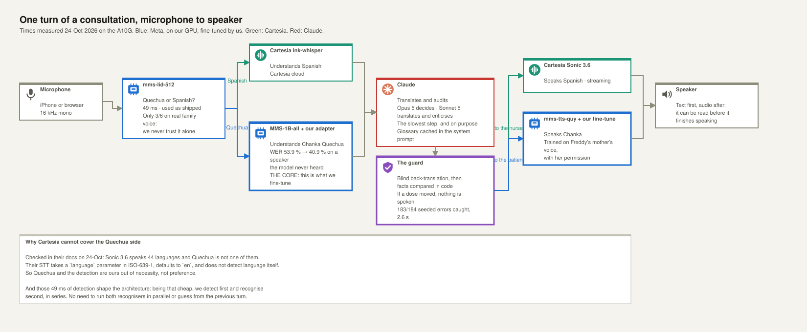
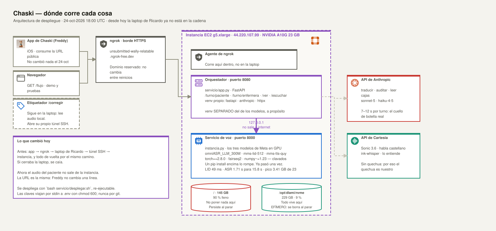
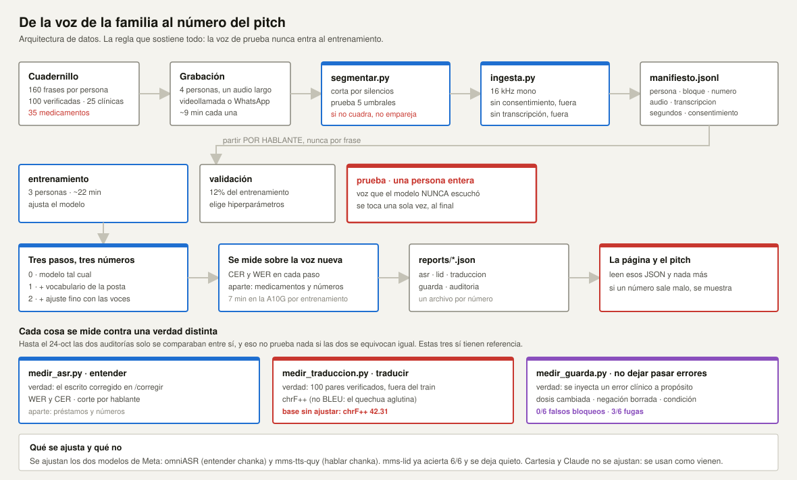

# Arquitectura de Chaski — modelos y datos

> Sábado 24 de octubre de 2026, 18:00 UTC. Todos los tiempos de este documento están medidos, no
> estimados: `reports/tiempos-instancia.md`, `reports/lid.json`, `reports/traduccion.json`,
> `reports/guarda.json`.
>
> **Los diagramas vienen en dos formatos.** El `.svg` es el que se ve aquí mismo y en GitHub. El
> `.drawio` de `reports/drawio/` es el editable: se abre en [draw.io](https://app.diagrams.net) con
> *File → Open*, o con la extensión de draw.io en VS Code, y trae las figuras como objetos movibles.
> Los tres se regeneran con `uv run --with pillow python reports/drawio/generar.py` (Pillow es para
> reducir el arte de Chaski a 64 px), así que conviene editar el script si el cambio es de contenido,
> y draw.io si es de posición. Los iconos van incrustados como data URI en los dos formatos: no hay
> archivos sueltos que se pierdan al mover el diagrama de carpeta.

> **Cambio de hoy:** el orquestador ya no corre en la laptop de Ricardo. Vive en la instancia, al lado
> de los modelos. La URL pública es la misma y Freddy no cambia nada. Ver la sección 2.

## 1. Un turno de consulta

> Editable: [`drawio/arquitectura-flujo.drawio`](drawio/arquitectura-flujo.drawio)

Cuatro proveedores, y cada uno hace lo que hace mejor:

| Trabajo | Quién | Dónde corre | ¿Se ajusta? |
|---|---|---|---|
| Detectar el idioma del turno | `facebook/mms-lid-512` | Nuestra GPU | **No.** Ya acierta 6/6 |
| Entender quechua chanka | `omniASR_LLM_300M` | Nuestra GPU | **Sí. Es el núcleo técnico** |
| Entender castellano | Cartesia `ink-whisper` | Nube de Cartesia | No |
| Decidir, corregir, traducir, auditar | Claude | Nube de Anthropic | No |
| Hablar castellano | Cartesia Sonic 3.6 | Nube de Cartesia | No |
| Hablar quechua chanka | `facebook/mms-tts-quy` | Nuestra GPU | **Sí**, con la voz de la mamá de Freddy |

**Por qué Cartesia no puede hacer el lado quechua.** Verificado en su documentación el 24-oct: Sonic 3.6
habla 44 idiomas y **el quechua no está entre ellos**; su STT acepta un parámetro `language` en ISO-639-1
con `en` por defecto y **no tiene detección automática de idioma**. Así que el quechua y la detección son
nuestros por necesidad, no por preferencia.

**Por qué Cartesia sí se gana el castellano.** Es streaming, suena mucho mejor que MMS en castellano, y
usar sus dos mitades (entender y hablar) en vez de solo la voz hace que su track sea defendible.

## 2. Dónde corre cada cosa

> Editable: [`drawio/arquitectura-despliegue.drawio`](drawio/arquitectura-despliegue.drawio)

Hasta esta mañana la cadena era **app → ngrok → laptop de Ricardo → túnel SSH → instancia**, y de
vuelta por el mismo camino. Dos cosas malas de eso: si Ricardo cerraba la laptop se caía el backend de
Freddy, y el audio del paciente cruzaba internet dos veces para llegar a una GPU que ya estaba
esperándolo.

Ahora el orquestador corre en la instancia, en el puerto 8080, y habla con el servicio de voz por
`127.0.0.1`. ngrok también corre ahí. El audio ya no sale de la máquina.

| | Puerto | Qué corre | venv |
|---|---|---|---|
| Orquestador | 8080 | `servicio/app.py`, FastAPI | propio: fastapi, anthropic, httpx |
| Voz | 8000 | los tres modelos de Meta | el de los modelos: torch 2.8.0, fairseq2, numpy ~1.23 |

**Los venv están separados a propósito.** El de los modelos tiene versiones clavadas por fairseq2, y
un `pip install` encima lo rompe — ya pasó una vez y costó una tarde.

Dos detalles de disco que importan si hay que reconstruir:

- `/` tiene 145 GB y está al **90 %**. No poner nada nuevo ahí.
- `/opt/dlami/nvme` tiene 229 GB al 9 %, y es donde vive todo — pero es **efímero**: se borra al parar
  la instancia. El respaldo está en `~/chaski-respaldo`, que sí persiste.

El despliegue es `bash servicio/desplegar.sh`, re-ejecutable. Las claves viajan por stdin a un `.env`
con `chmod 600`; nunca por git.

El etiquetador (`/corregir`) se queda en la laptop porque lee audio local, y abre su propio túnel SSH
cuando lo necesita.

## 3. La espera por turno

| Paso | Medido |
|---|---|
| Detectar idioma (`mms-lid-512`) | **49 ms** de mediana, 160 ms el peor caso |
| Entender quechua (`omniASR_LLM_300M`) | **1.71 s** para 15.8 s de audio · factor 0.11 |
| Cargar el modelo al arrancar | 20.17 s el ASR, 27.81 s el detector · una sola vez |
| Pico de GPU | 3.41 GB de 23 disponibles |
| Claude y la voz de salida | por medir |

**Esos 49 ms deciden la arquitectura.** Con una detección tan barata, se puede detectar primero y
reconocer después, en serie. No hace falta correr los dos reconocedores en paralelo ni adivinar el idioma
por el turno anterior. Un paso menos, una cosa menos que puede fallar en el demo.

## 4. El caso que no tiene respuesta correcta

«Mamáy, tome una pastilla cada ocho horas» es castellano con quechua adentro, y es exactamente como se
habla en una posta. `mms-lid` lo llama castellano en los tres audios de prueba.

No está mal: el castellano es la lengua matriz de esa frase. Pero **no se cuenta ni como acierto ni como
error**, porque no hay una respuesta única. Se reporta aparte. Si en la consulta real resulta frecuente,
la salida es la alternancia de turnos: en una consulta hablan por turnos, así que el turno que sigue al
de la enfermera es del paciente.

## 5. De la voz de la familia al número del pitch

> Editable: [`drawio/arquitectura-datos.drawio`](drawio/arquitectura-datos.drawio)

La regla que sostiene toda la medición: **el conjunto de prueba es una persona completa que el modelo
nunca escuchó.** Si se parte por frase, el modelo aprende la voz y el número deja de significar nada.
Está en el código, no solo en el protocolo: `partir_por_hablante` lanza un error si hay menos de dos
personas, y los tests lo fijan.

Tres pasos, tres números, y se reportan los tres salga lo que salga:

1. El modelo tal cual.
2. Más el vocabulario de la posta.
3. Más el ajuste fino con las voces de las familias.

## 6. Qué ajustamos, y por qué ahí

La prueba de humo mostró dónde falla el modelo base: en los **préstamos del castellano**.
`doctor` → `luctor`, `jefelláy` → `que fillay`. Son palabras que no existen en quechua pero que un
hablante de chanka pronuncia a su manera, y son justo las que no se pueden equivocar en una posta:
los nombres de los medicamentos y las dosis.

Por eso el cuadernillo tiene un bloque de 35 préstamos, con la instrucción de decirlos **como se dicen en
la posta, no como los leería un locutor**.

Y son **dos ajustes distintos**, que conviene no mezclar:

| | Entender (`omniASR`) | Hablar (`mms-tts-quy`) |
|---|---|---|
| Qué mejora | Que el modelo entienda el acento y los préstamos | Que Chaski suene familiar, no robótico |
| Qué datos quiere | **Muchas voces distintas** | **Una sola voz consistente** |
| De quién | Los cuatro: tu papá y los papás de Freddy | Solo la mamá de Freddy |
| Qué número da | CER y WER antes y después | Juicio a ciegas de ella |

Esa tensión es la razón de que el protocolo pida que todos graben el bloque de frases, pero que la voz de
Chaski salga de una sola persona.

## 7. Cómo se mide cada cosa

El detalle está en `reports/metricas.md`, bloque por bloque de `frases.json`. Lo corto: cada cosa se
mide contra una verdad distinta, y hasta hoy la auditoría no tenía ninguna — solo se comparaba con la
de Freddy, que no prueba nada si las dos se equivocan igual.

| Qué | Script | Contra qué verdad | Medido |
|---|---|---|---|
| Entender chanka | `voz/medir_asr.py` | el escrito corregido en `/corregir` | falta voz humana |
| Traducir | `voz/medir_traduccion.py` | 100 pares verificados, fuera del entrenamiento | chrF++ **42.31** |
| No dejar pasar errores | `voz/medir_guarda.py` | se inyecta un error clínico a propósito | **0/6** falsos bloqueos, **3/6** fugas |
| Estabilidad del veredicto | `voz/medir_auditoria.py` | la misma frase, varias corridas | la de 4 llamadas da `sí, no, sí` |

Sobre la traducción: el modelo base no falla gramática, falla **registro**. Dice `Señor, ¿imaynallam
kachkanki?` donde la referencia dice `Taytáy, ¿allillanchu?`. Eso es exactamente lo que arregla
ajustar con habla de la familia, así que el número va a subir por algo real.

Sobre la guarda: las tres fugas son graves, y en las tres **la retraducción había captado el error en
castellano**. Lo que lo perdió fue la extracción a `Hechos`, que no tiene campo para duración del
tratamiento ni para ayuno, y donde negar una condición de alarma sobrevive como el mismo `ir_ya_si`.
La peor invierte cuándo traer a un bebé que no se mueve. Está escrito en `servicio/PARA-FREDDY.md`
porque el esquema es suyo.

## 8. Lo que falta medir

- Cuánto tarda Cartesia en hablar, y si el streaming se nota.
- La línea base de ASR sobre voz humana, no sintética.
- `mms-lid` sobre voz humana con ruido de posta, que es otra cosa que sobre audio limpio.
- Si el chanka **suena natural**. Ninguna métrica de aquí lo dice: chrF compara contra una referencia
  escrita y no sabe si la frase suena a traducción. Eso lo decide la mamá de Freddy.
